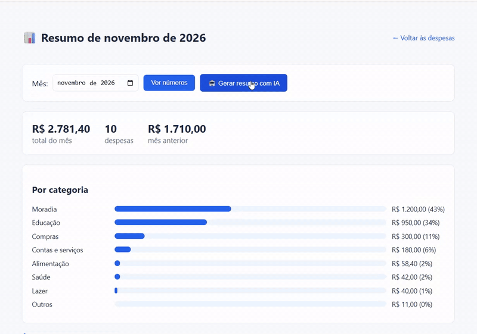

# 💰 Sistema de Controle de Despesas

Aplicação web desenvolvida em PHP para gerenciamento de gastos pessoais.  
Permite que usuários façam login e gerenciem suas despesas de forma simples e organizada.

---
## 🌐 Deploy Online

Você pode acessar o projeto rodando ao vivo aqui:
 [https://controle-despesas-bsnc.onrender.com](https://controle-despesas-bsnc.onrender.com)

---

## 📌 Visão Geral

Este sistema permite:

- Registrar despesas com descrição, valor e data
- Editar despesas existentes
- Excluir despesas
- Visualizar todas as despesas cadastradas
- Calcular automaticamente o total de gastos
- **Categorizar cada despesa automaticamente com IA** (Google Gemini)
- **Ver o resumo do mês** por categoria, com comparação com o mês anterior e um texto explicativo gerado por IA
- Acessar o sistema com autenticação (login)

---

## 🖥️ Interface

A aplicação possui interface gráfica (GUI), acessada via navegador, contendo:

- Formulário de cadastro e edição
- Tabela de listagem de despesas
- Botões de ação (editar e excluir)
- Tela de login

---

## 🤖 Categorização com IA

Ao cadastrar ou editar uma despesa, o sistema envia a descrição e o valor para a API do **Google Gemini**, que escolhe uma categoria entre: Alimentação, Transporte, Moradia, Saúde, Educação, Lazer, Compras, Contas e serviços e Outros.

- **Saída estruturada:** a API é configurada para responder em JSON, com a categoria restrita a essa lista (`responseSchema` com `enum`).
- **Validação no código:** mesmo assim, o PHP confere se a categoria recebida está na lista.
- **Fallback:** se a API falhar, demorar mais de 8 segundos, não houver chave configurada ou a resposta for inesperada, a despesa é salva com a categoria **Outros**. O cadastro nunca deixa de funcionar por causa da IA.
- **Temperatura 0:** a mesma descrição gera sempre a mesma categoria.

Código: [`src/categorizar.php`](src/categorizar.php).

---

## 📊 Resumo do mês com IA

<!-- Coloque aqui o GIF da demonstração:  -->

Na página **Resumo do mês**, a pessoa escolhe o mês e vê o total, a quantidade de despesas, o total do mês anterior e quanto gastou em cada categoria. Ao clicar em **Gerar resumo com IA**, o Gemini escreve um texto curto explicando esses números.

- **Os números são calculados pelo código, não pela IA.** O PHP soma as despesas; a IA só transforma os totais em texto. Assim, os valores da tabela estão sempre certos.
- **A IA recebe só os totais por categoria**, nunca as descrições das despesas (menos dados pessoais enviados e menos tokens).
- **Prompt com regras:** usar somente os números enviados, comparar com o mês anterior, terminar com uma sugestão gentil e responder em texto simples.
- **A IA só é chamada quando a pessoa clica no botão**, para não gastar a cota da API a cada visita.
- **Fallback:** se a API falhar, os números continuam na tela e aparece um aviso. Mês sem despesas não chama a IA.
- **Saída tratada:** o texto é escapado com `htmlspecialchars` (proteção contra XSS), tem asteriscos de markdown removidos e tamanho máximo.
- **Logs e nova tentativa:** falhas da IA são registradas nos logs (sem a chave nem dados das despesas), e erros passageiros (429, 500, 503) ganham uma segunda tentativa.

Código: [`resumo.php`](resumo.php), [`src/resumo.php`](src/resumo.php) e [`src/gemini.php`](src/gemini.php) (chamada à API compartilhada pelas duas funcionalidades).

---

## 🛠️ Tecnologias Utilizadas

- PHP
- PostgreSQL
- Google Gemini API
- Docker e Render (deploy)
- HTML
- CSS
- GitHub Actions (CI)

---

## 📁 Estrutura do Projeto

```
controleDespesas/
│
├── .github/
│ └── workflows/
│ └── ci.yml
│
├── src/
│ ├── conexao.php
│ ├── inserir.php
│ ├── editar.php
│ ├── excluir.php
│ ├── gemini.php        # chamada à API do Gemini (logs e nova tentativa)
│ ├── categorizar.php   # categorização com IA
│ └── resumo.php        # cálculos e texto do resumo do mês
│
├── tests/
│ ├── testes.php
│ ├── teste_categorizar.php
│ ├── teste_resumo.php
│ └── teste_integracao.php
│
├── index.php
├── resumo.php          # página do resumo do mês
├── login.php
├── logout.php
├── lint.bat
└── README.md
```

---

## ⚙️ Pré-requisitos

- XAMPP (ou outro servidor com PHP)
- PostgreSQL instalado
- Navegador web

---

## 🗄️ Configuração do Banco de Dados

### 1. Criar o banco

CREATE DATABASE controle_despesas;

---

### 2. Criar as tabelas
```
CREATE TABLE usuarios (
    id SERIAL PRIMARY KEY,
    email VARCHAR(100) NOT NULL,
    senha VARCHAR(255) NOT NULL
);
```
```
CREATE TABLE despesas (
    id SERIAL PRIMARY KEY,
    descricao VARCHAR(255) NOT NULL,
    valor DECIMAL(10,2) NOT NULL,
    data DATE,
    categoria VARCHAR(30) NOT NULL DEFAULT 'Outros'
);
```
---

### 3. Inserir um usuário (ambiente local)

INSERT INTO usuarios (email, senha)
VALUES ('seu-email@exemplo.com', md5('sua-senha'));

O sistema não possui cadastro de usuários pela interface: o acesso só é possível com usuários cadastrados no banco.

---

## 🚀 Como Executar o Projeto

### 1. Clonar o repositório

git clone https://github.com/maria-morena/controleDespesas.git

---

### 2. Colocar na pasta do servidor

C:\xampp\htdocs\

---

### 3. Configurar as variáveis de ambiente

As credenciais **não ficam no código**. Configure estas variáveis de ambiente (no Render, em *Environment*; localmente, no Apache ou no sistema):

| Variável | Para que serve |
|---|---|
| `DB_HOST`, `DB_PORT`, `DB_NAME`, `DB_USER`, `DB_PASS` | Conexão com o PostgreSQL |
| `GEMINI_API_KEY` | Chave da API do Gemini (Google AI Studio). Sem ela, todas as despesas ficam como "Outros" |
| `GEMINI_MODEL` | Opcional: modelo do Gemini a usar |

---

### 4. Iniciar o servidor

Abra o XAMPP e inicie o Apache.

---

### 5. Acessar no navegador

http://localhost/controleDespesas/login.php

---

## 🧪 Testes Automatizados

Cenários testados:

- Caminho feliz (valor positivo)
- Valor negativo (inválido)
- Valor zero (caso limite)
- Descrição vazia (inválido)
- Valor muito alto (caso extremo)

Categorização com IA ([`tests/teste_categorizar.php`](tests/teste_categorizar.php)), usando **respostas simuladas** da IA, sem chamar a API real:

- Categoria válida é aceita
- Categoria fora da lista vira "Outros"
- Falha da API, resposta que não é JSON ou erro na chamada viram "Outros"
- Descrição vazia vira "Outros" sem chamar a IA
- O prompt leva a descrição e a lista de categorias

Resumo do mês ([`tests/teste_resumo.php`](tests/teste_resumo.php)), também com respostas simuladas:

- Soma do total, agrupamento por categoria e categoria vazia como "Outros"
- Datas do mês, inclusive a virada de dezembro para janeiro, e texto inválido no filtro
- O prompt leva os totais e a regra de não inventar números
- Texto válido é devolvido; asteriscos são removidos; texto longo é cortado
- Falha da API, resposta vazia ou erro na chamada não quebram a página
- Mês sem despesas não chama a IA

### Executar testes

C:\xampp\php\php.exe tests/testes.php

C:\xampp\php\php.exe tests/teste_categorizar.php

C:\xampp\php\php.exe tests/teste_resumo.php

---

## 🔍 Lint (Verificação de Código)

Execute:

lint.bat

---

## ⚙️ Integração Contínua (CI)

Executa automaticamente:

- Verificação de sintaxe (lint)
- Testes automatizados
- Testes da categorização com IA (respostas simuladas)
- Testes do resumo do mês (respostas simuladas)
- Teste de integração com a API de cotação

Em:

- push
- pull request

Arquivo:

.github/workflows/ci.yml

---

## ⚠️ Possíveis Problemas

### PHP não reconhecido

Use:

C:\xampp\php\php.exe

---

### Erro no banco

Verifique:

- as variáveis de ambiente do banco (`DB_HOST`, `DB_USER`, `DB_PASS`...)
- se o PostgreSQL está ativo

---

## 📌 Limitações

- Uso de MD5 (não recomendado em produção)
- Sem cadastro de usuários via interface
- Sem separação por usuário
- A categoria é sugerida pela IA e pode errar em descrições ambíguas
- O texto do resumo é gerado por IA: o prompt proíbe inventar números, mas o código não confere cada frase. Por isso a tabela com os valores reais fica sempre ao lado do texto

---

## 🚀 Melhorias Futuras

- password_hash
- Cadastro de usuários
- Permitir corrigir a categoria manualmente

---

## 👩‍💻 Autora

Maria Morena

---

## 📄 Licença

Projeto acadêmico para fins educacionais.
